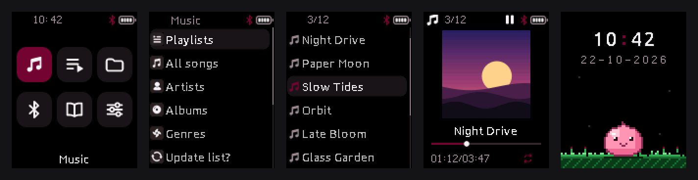
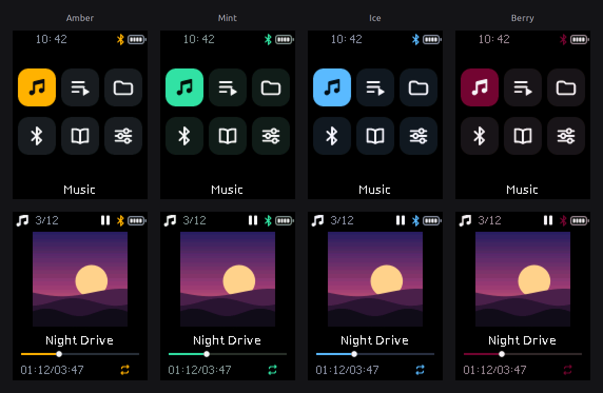

# ODEJOI X91 firmware

Custom firmware for the ODEJOI X91 MP3 player (Actions ATJ2157). The stock firmware was dumped over USB and
reverse-engineered; a new interface, **Graphite**, is built on top of it in stages (24 so far) by scripts that patch
the stock image. A terminal tool dumps the firmware and flashes a theme.





## Quick start

Fetch the `actions_flash` submodule and build the USB tool once:

```bash
git submodule update --init
make -C actions_flash
make -C actions_flash/payload_arm TOOLCHAIN=arm-none-eabi CC="arm-none-eabi-gcc -march=armv7-m -mthumb"
```

Rebuild every stage for every theme from the stock dump (`x91_dump/x91_lfi_verified.bin`, not in git):

```bash
python3 -I design/build_theme.py
```

Dump the firmware or flash a theme:

```bash
python3 x91_tool.py
```

Requirements, the files that are not in git and where they come from: `docs/quickstart.md`. The stock firmware and
vendor files are not part of this repository; outside sources and their versions are in `docs/project/sources.md`.

## Layout

| Path | What it is |
|---|---|
| `x91_tool.py` | Terminal tool: dump, flash a theme, roll back |
| `x91_dump/x91_flash.py` | The flash procedure the tool drives |
| `design/` | Stage builders (`build_stageN.py`, `build_theme.py`), theme colours, patches, new C code, design sources |
| `firmware_analysis/tools/` | Image container, resource previewer, disassemblers, cover and playlist tools |
| `actions_flash/` | Submodule: upstream USB client for the chip's upgrade mode |
| `patches/` | Our patch to `actions_flash` for the first dump |
| `docs/` | Documentation of the firmware and of this code (Sphinx) |

## Documentation

```bash
make -C docs html
```

Then open `docs/_build/html/index.html`. Start with the overview and the quick start; the firmware reference covers
the image format, programs, resources, display driver, shared code, music engine and the flash procedure.

## Warning

Flashing can brick the player. No hardware key for upgrade mode is known; recovery depends on the USB-drive program
still starting. Read `docs/firmware/hardware.md` and `docs/firmware/flashing.md` first.
